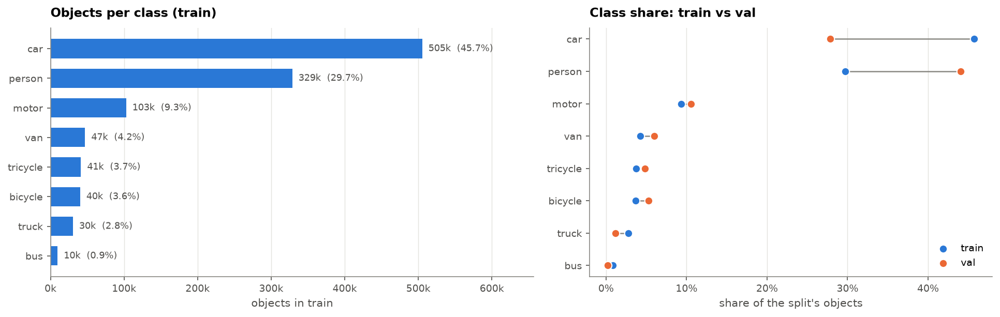
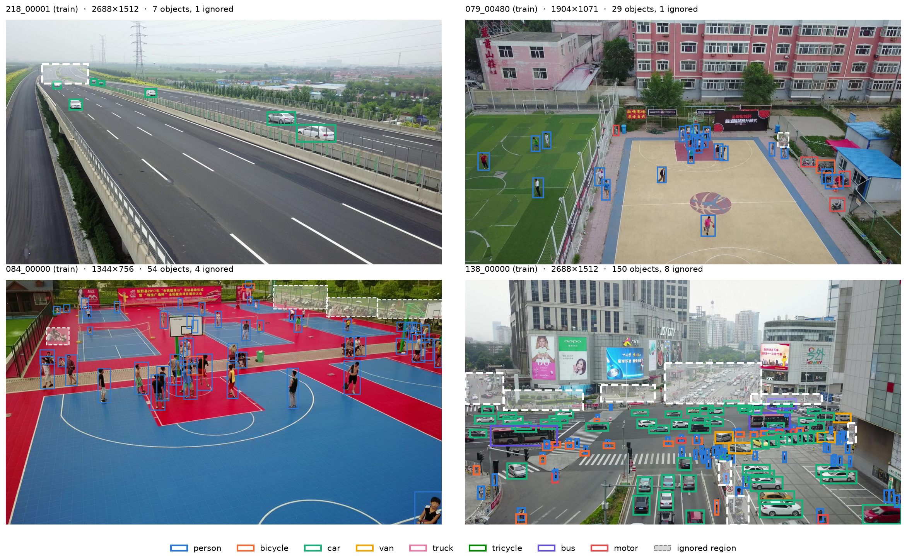
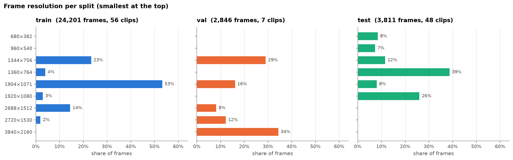
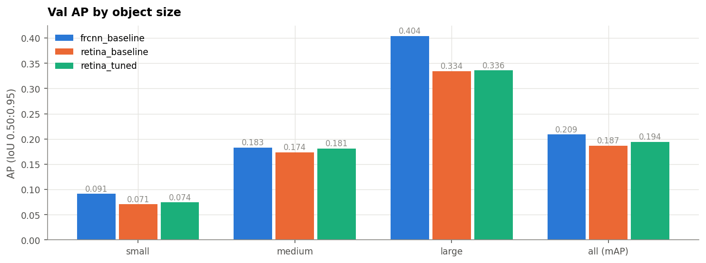
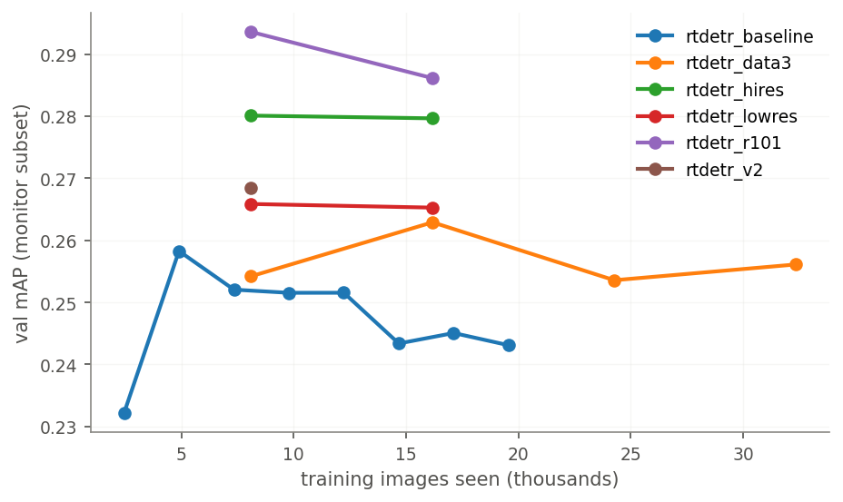
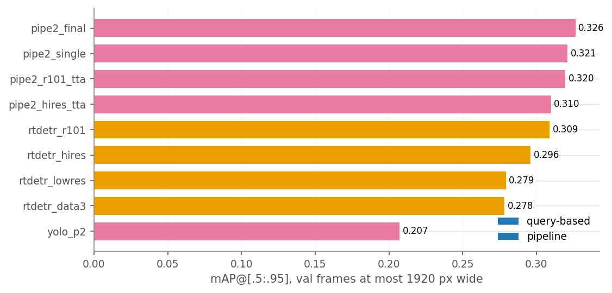

## Introduction

The task is to detect objects of 8 clases in frames of drone videos. For every frame the model has to output boxes, a class and a confidence score for each box. The quality is measured with COCO mAP@[.5:.95] on a Kaggle leaderboard. The main difficulty of this data is that objects are very small and scenes are crowded, while neighbouring frames of a video look almost the same

The work was done in steps. First I explored the data then I trained four detector families with one shared protocol and tried several modifications for each of them. After that I scaled up the strongest model and built an inference pipeline on top of it, with test-time augmentation, an ensemble and a temporal rescoring step. All the code is in the `notebooks/` folder, and all metrics are saved in `results/`.

## Method
### EDA
EDA is covered in notebooks/01_eda.ipynb

1. Class distribution
 
Plot shows class imbalance: car and pearson classes together cover around 75% of training data. Also in test dataset cars are the dominant class, when in validation dataset - pedestrians. 

2. Object sizes 
Most of the objects are in 16-96 px range and many of them under 32 px 

3. Crowded scenes
 
Many scenes are crowded, median is 43 objects per frame, highest value - 180. So defoult value of 100 boxes is changed to 300

4. Too dense areas
Areas, that are too dence to label take around 2.4% of image. They are filled with gray color for training

5. Frames are nearly identical

Median of overlap of the same object boxes between previous and next frame is 0.9
To save on the compute keep only every 10th frame for training

6. Train - validation split
Spliting 1 video on train and val sets would be a data leakadge, so different videos go to different sets

7 Resolution
 
There are visible gap in resolution distribution in sets. Test set contains images of resoluion, that is not even present in train and val sets

### Evaluation metrics
| Metric        | What it means                                                                        |
|---------------|--------------------------------------------------------------------------------------|
| IoU           | How 2 boxes overlap: shared area ÷ combined area                                     |
| Precision     | Part of predicted boxes that are correct                                             |
| Recall        | Part of real objects that the model found                                            |
| AP            | Precision averaged over all recall levels, boxes sorted by confidence; per class.    |
| mAP@[.5:.95]  | AP averaged over 8 classes and 10 IoU thresholds (from 0.50 to 0.95 with step .05)   |
| AP50          | AP at IoU 0.5 only: was the object found at all, even roughly                        |
| AP75          | AP at IoU 0.75: is the box tight                                                     |
| AP_small      | mAP for objects with side < 32 px                                                    |
| AP_medium     | mAP for objects with side 32–96 px                                                   |
| AP_large      | mAP for objects with side > 96 px                                                    |
| AR_500        | Part of real objects found when up to 500 boxes per image are allowed                |
| ms per image  | Time to process one frame on the GPU (speed)                                         |

Because of the resolution gap found in the EDA, just the validation mAP does not describe the test set well enough. For the final experiments I used a "test-like" score: 0.84 × mAP on validation frames resized to at most 1920 px, plus 0.16 × the mean mAP on the same frames shrunk to 960 px and 680 px. The weights have the same share of such resolutions as in the test set.

### Shared training and evaluation protocol for all models
| Setting                | Value                                              |
|------------------------|----------------------------------------------------|
| Training frames        | every 10th frame (2,446 frames from 56 clips)      |
| Epochs                 | 8                                                  |
| Batch size             | 4 images                                           |
| Optimiser              | SGD with momentum 0.9                              |
| Weight decay           | 1e-4                                               |
| Learning-rate schedule | cosine, 300 warm-up steps                          |
| Learning rate          | 0.02 Faster R-CNN; 0.01 RetinaNet and FCOS         |
| Mixed precision (AMP)  | on                                                 |
| Augmentation           | horizontal flip, probability 0.5                   |
| Input size             | short side 800 px, long side ≤ 1333 px             |
| Start weights          | pretrained on COCO                                 |
| Boxes kept per image   | 300                                                |
| Score threshold        | 0.001                                              |

For every family I first trained a baseline with default settings and then changed one thing at a time. That allows to compare each change to the baseline directly

### Faster R-CNN, two-stage 
notebook 02

Faster R-CNN works in two stages. First, a small network (RPN) proposes regions where an object may be, then the second stage clasifies each region and corrects its box.

| Run           | Change                             | Idea                             |
|---------------|------------------------------------|----------------------------------|
| baseline      | defaults, LR 0.02                  | reference                        |
| small_anchors | anchors 16–256 px, 2× proposals    | small, dense objects             |
| roi_sampling  | 1024 RoIs, 50% positives           | dense frames have many positives |
| giou          | GIoU box loss instead of smooth L1 | IoU loss matches the metric      |

### RetinaNet, one-stage
notebook 03

RetinaNet predicts classes and boxes directly from a dense grid of anchors in one pass. To deal with the huge number of easy background anchors, it uses the focal loss.

| Run      | Change                                    | Idea                                      |
|----------|-------------------------------------------|-------------------------------------------|
| baseline | defaults                                  | reference                                 |
| anchors  | anchors from EDA sizes, 16–406 px         | anchors should match real object sizes    |
| focal    | focal-loss gamma 1.5 instead of 2         | less down-weighting of easy anchors       |
| iou      | positive anchors at IoU ≥ 0.4, negative < 0.3 | small objects get more positive anchors |
| tuned    | anchors 16–645 px + gamma 1.5             | combine the best changes                  |

### FCOS, anchor-free
notebook 04

FCOS does not use anchors at all every point of the feature map that falls inside an object predicts the distanses to the four sides of the box.

| Run      | Change                            | Idea                                     |
|----------|-----------------------------------|------------------------------------------|
| baseline | defaults                          | reference                                |
| center   | centre radius 2.5 instead of 1.5  | more positive points for small objects   |
| ciou     | CIoU box loss instead of GIoU     | also penalise centre distance and shape  |
| p2       | extra P2 level (stride 4)         | finer feature map for tiny objects       |

### RT-DETR, query-based
notebook 05

RT-DETR is a transformer detector. It has a fixed set of object querries, and each query either predicts one object or "no object", so it does not need NMS It was trained with AdamW, learning rate 1e-4 (10 times lower for the backbone) and gradient clipping 0.1.

| Run      | Change                                 | Idea                                          |
|----------|----------------------------------------|-----------------------------------------------|
| baseline | paper defaults                         | reference                                     |
| denoise  | 500 denoising queries instead of 100   | enough denoising groups in dense frames       |
| matching | matching cost GIoU 4, L1 2 (was 2, 5)  | L1 on normalised boxes barely separates small objects |
| queries  | 500 object queries instead of 300      | the densest frames have up to 180 objects     |

### YOLOv8s-P2
notebook 06

As a fast second model, for the pipeline I trained YOLOv8s with an extra P2 head for small objects. It was trained with Ultralytics for 30 epochs at 1280 px on full frames and on 2×2 tiles of wide frames.

### Scaling RT-DETR
notebook 08

RT-DETR was clearly the strongest family, so i spent the remaining compute on it. Each run adds one change to the previous one.

| Run    | Change                                | Idea                                        |
|--------|---------------------------------------|---------------------------------------------|
| data3  | every 3rd frame instead of every 10th | 3.4× more training frames                   |
| hires  | + input 1080 × 1920                   | test frames are large, small objects stay visible |
| lowres | + 30% of frames downscaled            | imitate the low-resolution test images      |
| r101   | hires + ResNet-101 backbone           | a deeper backbone                           |

### Inference pipeline
notebooks 07 and 09

On top of the trained models I added three inference steps, each tuned on validation. Test-time augmentation (TTA) runs the model also on the flipped and on the 1.33× enlarged frame and merges all boxes with NMS. I also tried tiling where a wide frame is cut into tiles that are processed seperately. The ensemble merges boxes of two different models with NMS. Temporal rescoring uses the fact, that neighbouring frames are almost the same: if a box has a matching box in the previous or next frame, its score is increased, so random false positives lose their place in the ranking. The first version of the pipeline (notebook 07) combined RT-DETR R50 with YOLOv8s-P2. The final version (notebook 09) combined RT-DETR R101 with the high-resolution RT-DETR.

## Results

### Detector families

All numbers in this section are measured on the validation set. ms/img is the GPU time per image.

Faster R-CNN (notebook 02):

| Run | mAP | AP50 | AP75 | AP_small | AP_medium | AP_large | AR_500 | ms/img |
|---|---|---|---|---|---|---|---|---|
| baseline | 0.209 | 0.425 | 0.180 | 0.091 | 0.183 | 0.404 | 0.411 | 141 |
| small_anchors | 0.198 | 0.416 | 0.163 | 0.093 | 0.191 | 0.347 | 0.362 | 154 |
| roi_sampling | 0.205 | 0.417 | 0.176 | 0.091 | 0.185 | 0.387 | 0.388 | 140 |
| giou | 0.206 | 0.431 | 0.173 | 0.099 | 0.193 | 0.368 | 0.398 | 140 |

None of the experiments managed to beat the baseline. Smaller anchors performed better on tiny objects, but worse on large. GIoU found objects more often (AP50 0.431) but fitted boxes less tightly.

RetinaNet (notebook 03):

| Run | mAP | AP50 | AP75 | AP_small | AP_medium | AP_large | AR_500 | ms/img |
|---|---|---|---|---|---|---|---|---|
| baseline | 0.187 | 0.362 | 0.170 | 0.071 | 0.174 | 0.334 | 0.369 | 128 |
| anchors | 0.177 | 0.380 | 0.141 | 0.066 | 0.167 | 0.302 | 0.384 | 129 |
| focal | 0.189 | 0.365 | 0.173 | 0.071 | 0.172 | 0.344 | 0.365 | 129 |
| iou | 0.151 | 0.286 | 0.142 | 0.053 | 0.134 | 0.299 | 0.259 | 129 |
| tuned | 0.194 | 0.395 | 0.165 | 0.074 | 0.181 | 0.336 | 0.383 | 129 |

Only the combined run improved the baseline and only slightly. The looser anchor assignment hurt the most, because it marked many poorly overlaping anchors as objects.

FCOS (notebook 04):

| Run | mAP | AP50 | AP75 | AP_small | AP_medium | AP_large | AR_500 | ms/img |
|---|---|---|---|---|---|---|---|---|
| baseline | 0.189 | 0.385 | 0.166 | 0.095 | 0.174 | 0.334 | 0.412 | 212 |
| center | 0.174 | 0.348 | 0.156 | 0.094 | 0.160 | 0.320 | 0.388 | 212 |
| ciou | 0.190 | 0.387 | 0.167 | 0.096 | 0.173 | 0.340 | 0.410 | 211 |
| p2 | 0.199 | 0.399 | 0.174 | 0.098 | 0.184 | 0.352 | 0.441 | 509 |

The P2 level gave the best FCOS result, but it made the model more than two times slower (509 ms instead of 212 ms per image).

RT-DETR (notebook 05):

| Run | mAP | AP50 | AP75 | AP_small | AP_medium | AP_large | AR_500 | ms/img |
|---|---|---|---|---|---|---|---|---|
| baseline | 0.256 | 0.496 | 0.231 | 0.145 | 0.231 | 0.439 | 0.470 | 176 |
| denoise | 0.256 | 0.493 | 0.233 | 0.136 | 0.233 | 0.439 | 0.464 | 176 |
| matching | 0.249 | 0.481 | 0.227 | 0.144 | 0.226 | 0.422 | 0.423 | 177 |
| queries | 0.254 | 0.494 | 0.225 | 0.144 | 0.237 | 0.422 | 0.470 | 178 |

None of the changes helped, but even the RT-DETR baseline is far ahead of the other families, especialy on small objects (0.145 against at most 0.099). YOLOv8s-P2 (notebook 06) reached 0.201 mAP and 0.102 AP_small, close to the best CNN detectors.

| Run | mAP | AP50 | AP75 | AP_small | AP_medium | AP_large | AR_500 | ms/img |
|---|---|---|---|---|---|---|---|---|
| yolo_p2 | 0.201 | 0.400 | 0.177 | 0.102 | 0.190 | 0.335 | 0.317 | 148 |

### Scaling RT-DETR

| Run | mAP | AP50 | AP75 | AP_small | AP_medium | AP_large | AR_500 | ms/img | test-like | public LB |
|---|---|---|---|---|---|---|---|---|---|---|
| data3 | 0.261 | 0.502 | 0.237 | 0.141 | 0.240 | 0.441 | 0.463 | 182 | 0.279 | 0.2985 |
| hires | 0.276 | 0.528 | 0.252 | 0.165 | 0.247 | 0.465 | 0.435 | 361 | 0.295 | 0.2546 |
| lowres | 0.265 | 0.519 | 0.237 | 0.144 | 0.245 | 0.450 | 0.448 | 363 | 0.278 | – |
| r101 | 0.291 | 0.546 | 0.271 | 0.155 | 0.256 | 0.486 | 0.487 | 658 | 0.307 | 0.3200 |

More data, a higher resolution and a deeper backbone all improved validation. The R101 model was the best single model, both on validation and on the public leaderboard. The high-resolution model got a much lower public score than its validation suggested. The public leaderboard uses only 30% of the test frames, so this may be noise, but I couldn't check it

### Inference pipeline

In the first pipeline (notebook 07, plain validation mAP), flip TTA raised RT-DETR R50 from 0.263 to 0.272, while tiling gave no gain, and was much slower. The ensemble with YOLOv8s-P2 and temporal rescoring gave 0.273 on validation and 0.2993 on the public leaderboard.

The second pipeline (notebook 09) was tuned on the test-like score:

| Pipeline     | Parts                                         | test-like | AP_small | public LB |
|--------------|-----------------------------------------------|-----------|----------|-----------|
| r101 + TTA   | R101, flip                                    | 0.320     | 0.183    | –         |
| hires + TTA  | hires, flip + 1.33×                           | 0.310     | 0.197    | –         |
| pipe2_single | R101 flip + temporal                          | 0.321     | 0.184    | 0.3320    |
| pipe2_final  | R101 flip + hires flip/1.33× + temporal       | 0.3265    | 0.200    | 0.3315    |

The ensemble was the best pipeline on the test-like score, mostly because the high-resolution model adds small objects . On the public leaderboard both final pipelines are practically equal I chose these two as the final submissions.

## Final model and run instructions

The selected model is the ensemble `pipe2_final`: `rtdetr_r101` with flip TTA and `rtdetr_hires` with flip + 1.33× TTA, merged with NMS (IoU 0.6, equal weights), then temporal rescoring (window 1, λ 0.15). Test-like val 0.3265, public 0.3315. The second submission `pipe2_single` is the same without the ensemble (public 0.3320).

| Setting            | rtdetr_r101                    | rtdetr_hires                   |
|--------------------|--------------------------------|--------------------------------|
| Weights            | PekingU/rtdetr_r101vd (COCO)   | PekingU/rtdetr_r50vd (COCO)    |
| Config             | `configs/experiments/rtdetr_r101.yaml` | `configs/experiments/rtdetr_hires.yaml` |
| Training frames    | every 3rd frame                | every 3rd frame                |
| Input size         | 1080 × 1920                    | 1080 × 1920                    |
| Epochs, batch size | 2, 2                           | 2, 2                           |
| Optimiser          | AdamW, LR 1e-4, backbone ×0.1, gradient clipping 0.1 | same                 |
| Seed               | 42                             | 42                             |

Dependencies are Python ≥ 3.10, torch 2.11 with CUDA and `requirements.txt`. The first cell of each notebook installs them, clones the repo and loads the data. On Kaggle, attach the competition data and turn on Internet and GPU.

| Step | Notebook | Where | Inputs | Output |
|------|----------|-------|--------|--------|
| 1 | `06_pipeline_yolo.ipynb` | Colab T4 | competition data | `yolo-p2-run` dataset |
| 2 | `08_rtdetr_scaled.ipynb` | Kaggle GPU | competition data | `rtdetr_hires`, `rtdetr_r101` |
| 3 | `09_pipeline_final_v2.ipynb` | Kaggle GPU | outputs of steps 1 and 2 | `pipe2_final`, `pipe2_single` submission.csv |

If notebook 08 doesn't finish in one session, attach its output to the next one and finished runs are skipped.

## Conclusion

On this dataset, the transformer detector RT-DETR worked much beter than Faster R-CNN, RetinaNet and FCOS trained with the same protocol. Most of the small changes, to losses, anchors and label assignment did not beat the defaults. The biggest gains came from more training frames, a higher input resolution and a deeper backbone, and then from flip TTA, an ensemble and temporal rescoring at inference. The best submissions reach about 0.33 mAP on the public leaderboard, compared with 0.21 for the Faster R-CNN baseline on validation. Small objects are still the main weakness AP_small is about 0.20, while AP_large is about 0.58.
